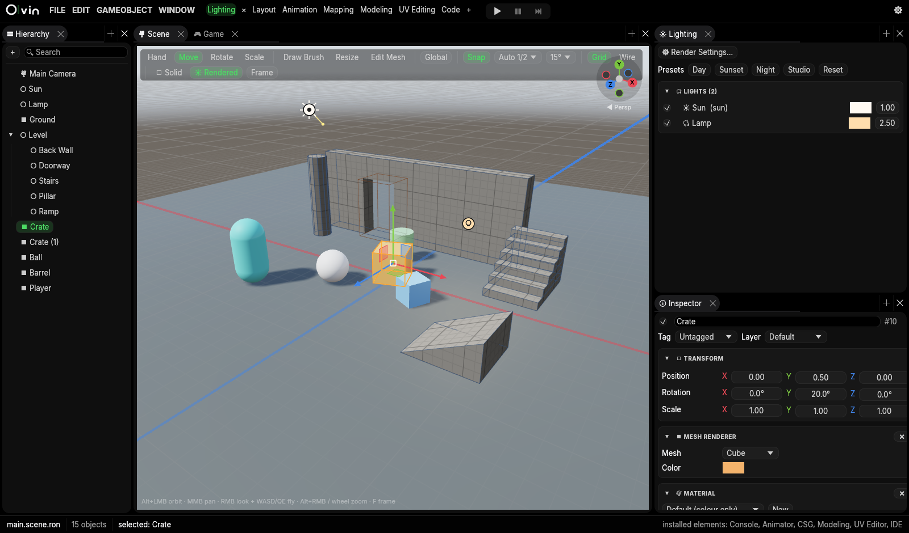
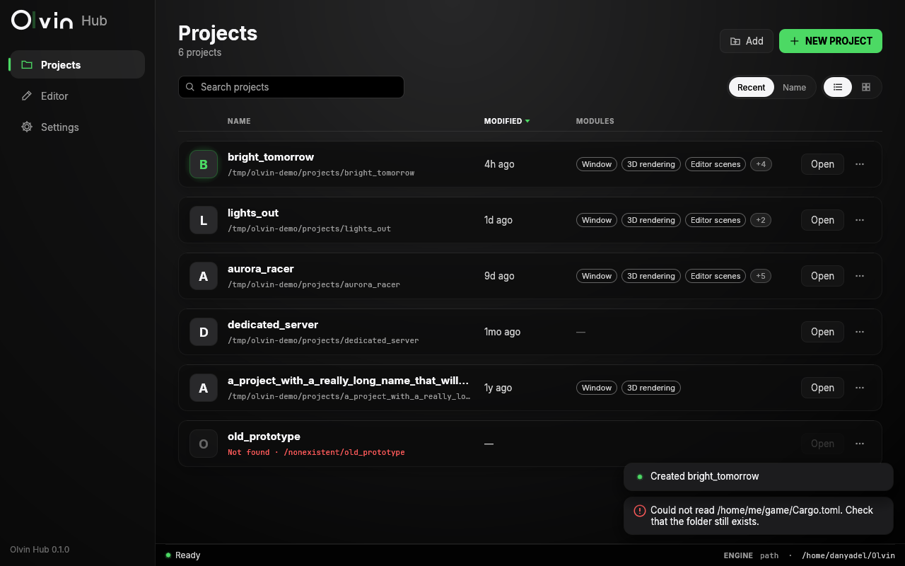
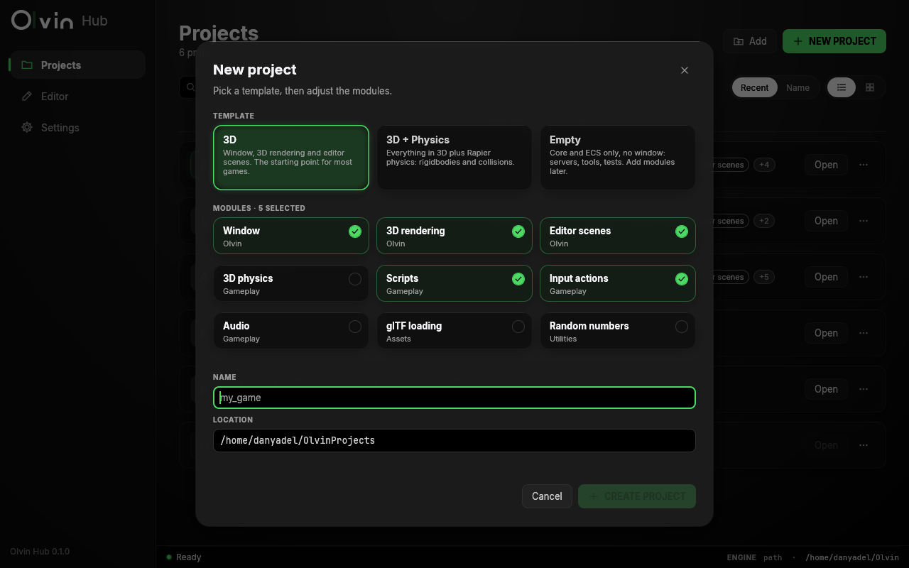
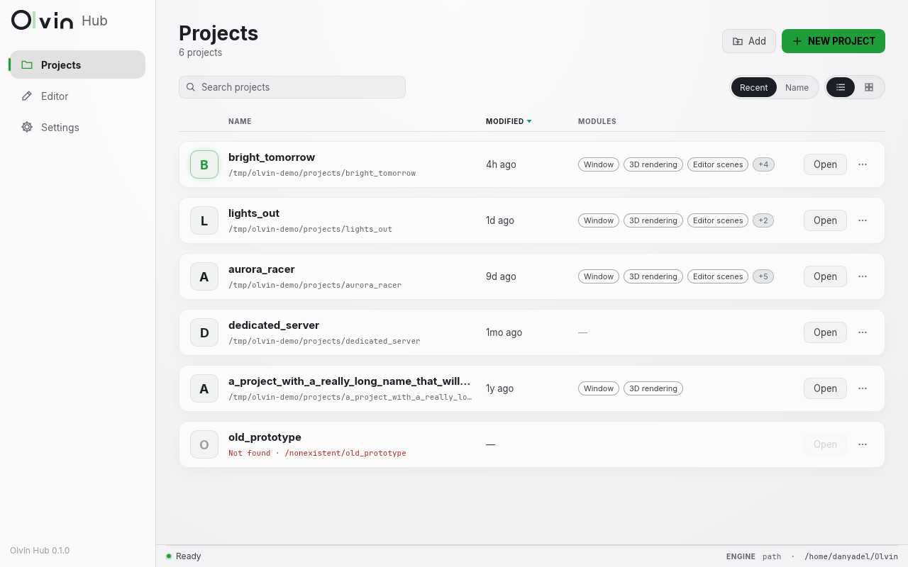
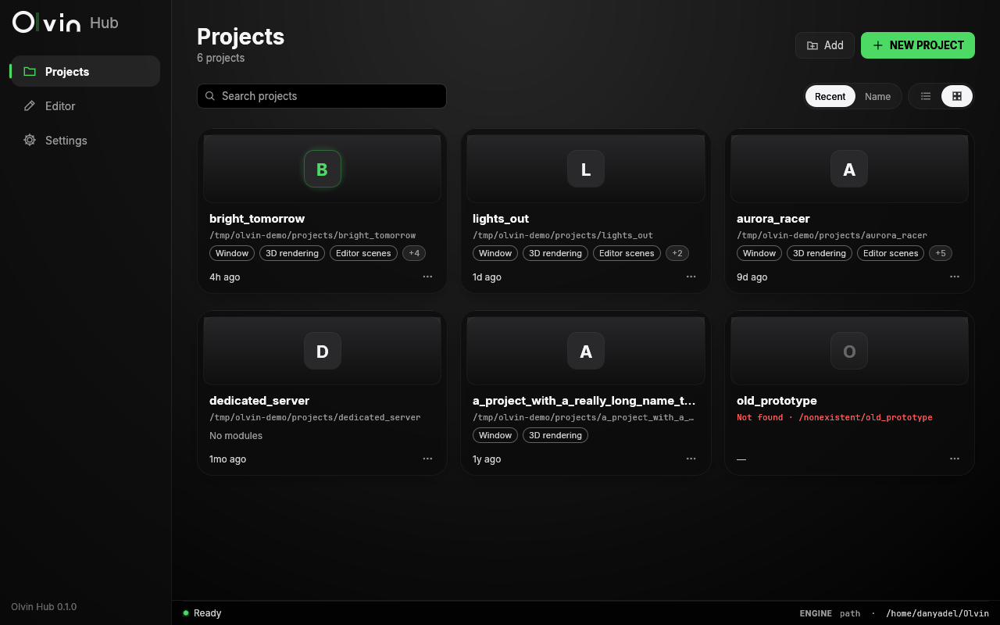
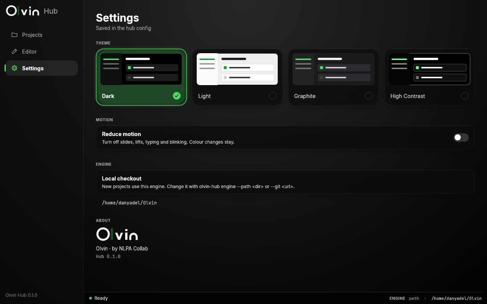
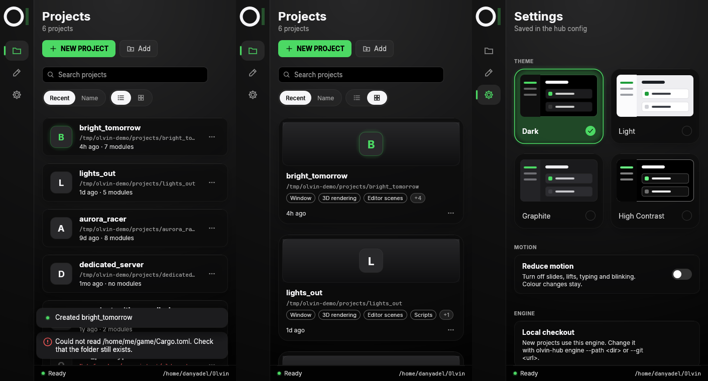
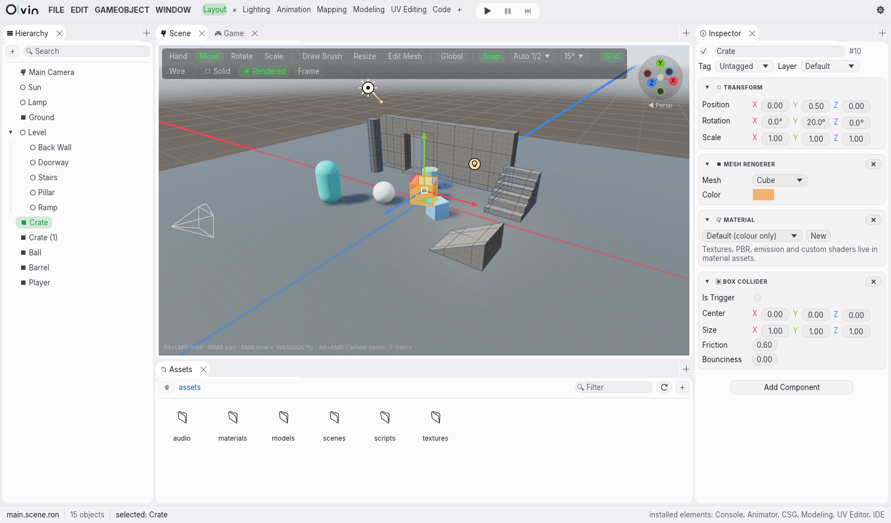

<p align="center">
  <picture>
    <source media="(prefers-color-scheme: dark)" srcset="assets/logo/variations/wordmark-flat-on-dark.svg">
    <source media="(prefers-color-scheme: light)" srcset="assets/logo/variations/wordmark-flat-on-light.svg">
    
  </picture>
</p>

<p align="center">
  A modular game engine in Rust by <a href="https://nlpacollab.neocities.org/">NLPA Collab</a>.<br>
  Core, ECS, window, rendering, physics and audio are separate plugin crates. A project hub and a scene editor come with it.
</p>

<p align="center">
  <a href="https://github.com/DanyaDel/Olvin/actions/workflows/ci.yml"></a>
  
  
</p>

<p align="center">
  
</p>

<p align="center"><a href="README.md">Русский</a></p>

## What's inside

- **Modularity at the subsystem level.** A plugin registers systems, and a system processes all its data in one call. Code you don't use isn't compiled.
- **Rendering on wgpu:** Vulkan / Metal / DX12 / GLES 3 / WebGL2 / WebGPU. Shadows, PBR materials (`*.mat.ron`), sky and environment, a Compat tier for weak GPUs.
- **Scenes and CSG:** the scene lives in `assets/scenes/main.scene.ron`, and the game loads it at startup together with the CSG brush geometry.
- **Physics** (Rapier), **audio** (kira, 3D), **input** with action maps, and **behaviours** written in Rust.
- **The hub** creates projects and installs modules. **The editor** is assembled from elements that you download one at a time.
- **Its own style:** four themes, Inter and JetBrains Mono fonts included, and a logo drawn from geometry. Details in [STYLE.md](STYLE.en.md).

## Quick start

```sh
cargo run -p sandbox --release                 # 40k cubes, WASD + RMB, Shift, Esc
OLVIN_CUBES=250000 cargo run -p sandbox --release
WGPU_BACKEND=gl cargo run -p sandbox --release # weak path (Compat tier)
```

You need Rust 1.95 or newer. On Linux you also need `libudev`, `alsa-lib`, `libxkbcommon` and `wayland` (on Arch these come with a desktop install).

Logs go to stderr and to `logs/<app>.log`. A panic leaves a report `logs/crash-<time>.txt` next to it. Levels: `OLVIN_LOG=debug` or `OLVIN_LOG=info,olvin_render=trace`.

## Hub

`olvin-hub` creates game projects and installs modules into them: window, rendering, physics, audio and so on. There is a command-line version and a graphical one.

<p align="center">
  
</p>

<table>
  <tr>
    <td></td>
    <td></td>
  </tr>
  <tr>
    <td align="center"><sub>New project: template and modules</sub></td>
    <td align="center"><sub>Light theme</sub></td>
  </tr>
  <tr>
    <td></td>
    <td></td>
  </tr>
  <tr>
    <td align="center"><sub>Grid view</sub></td>
    <td align="center"><sub>Settings: themes and "Reduce motion"</sub></td>
  </tr>
</table>

The layout adapts to the window width: a table on a wide screen, cards and a narrow icon bar on a narrow one.

<p align="center">
  
</p>

```sh
cargo install --path hub/olvin_hub_cli   # olvin-hub
cargo install --path hub/olvin_hub_gui   # olvin-hub-gui
olvin-hub new my_game && cd my_game
olvin-hub list                 # catalogue, [x] means installed
olvin-hub add physics audio
olvin-hub run --release
```

Hub settings (project list, theme, view) are stored in `~/.config/olvin-hub/config.toml`.

## Editor

The scene editor is installed separately. Its elements (console, animator, modeling, UV, IDE) are downloaded one at a time:

```sh
olvin-hub editor install          # base: scene, hierarchy, inspector, assets (+ console, CSG)
olvin-hub editor add animator     # Animator element and the Animation workspace
cd my_game && olvin-hub editor open
```

<p align="center">
  
</p>

The theme and "Reduce motion" are switched in Settings → Interface. To develop the editor itself, run `cargo run -p editor_dev -- <project folder>` (all elements at once).

## Layout

```
crates/   engine: olvin_core, olvin_ecs, olvin_window, olvin_render, olvin_scene, olvin_csg,
          olvin_mesh, olvin_assets, olvin_physics, olvin_audio, olvin_input, olvin_script,
          olvin_transform, olvin_ui (shared UI for the hub and the editor), olvin (facade)
editor/   olvin_editor and its elements: animator, console, csg, ide, modeling, uv
hub/      olvin_hub (core), olvin_hub_cli, olvin_hub_gui
apps/     sandbox, script_demo, editor_dev
assets/   logo and fonts
```

- [ARCHITECTURE.md](ARCHITECTURE.en.md): what each crate contains and how they fit together.
- [ROADMAP.md](ROADMAP.en.md): the plan towards a full engine.
- [STYLE.md](STYLE.en.md): colours, fonts, motion, copy. Logo: [assets/logo/README.md](assets/logo/README.en.md).

## Development

```sh
cargo fmt --all --check
cargo clippy --workspace --all-targets -- -D warnings
cargo test --workspace
```

Screenshots for this README are rendered without a window, through llvmpipe:

```sh
export __EGL_VENDOR_LIBRARY_FILENAMES=/usr/share/glvnd/egl_vendor.d/50_mesa.json WGPU_BACKEND=gl
OLVIN_HUB_SHOTS=target/hub-shots OLVIN_HUB_SHOTS_ROOT=/tmp/olvin-demo \
  cargo test -p olvin_hub_gui -- --ignored screenshots
cargo test -p editor_dev --test screenshots -- --ignored   # docs/screenshots/editor-*.png
```

## Known limitations

- **GL on proprietary NVIDIA under Wayland does not work.** The EGL driver does not provide a native-renderable config, and wgpu refuses to present frames. This is a wgpu limitation, not an engine one. Workaround: stay on Vulkan (the default, do not set `WGPU_BACKEND`), and to test the GL path run on Mesa llvmpipe:

  ```sh
  __EGL_VENDOR_LIBRARY_FILENAMES=/usr/share/glvnd/egl_vendor.d/50_mesa.json WGPU_BACKEND=gl cargo run -p sandbox --release
  ```

- The hub and the editor are in English for now; the documentation is in Russian (this file is the English version).

## License

Choose either [MIT](LICENSE-MIT) or [Apache-2.0](LICENSE-APACHE). The Inter and JetBrains Mono fonts are under the OFL; their licences are in `assets/fonts/`.

<p align="center"><sub>Olvin · by NLPA Collab</sub></p>
