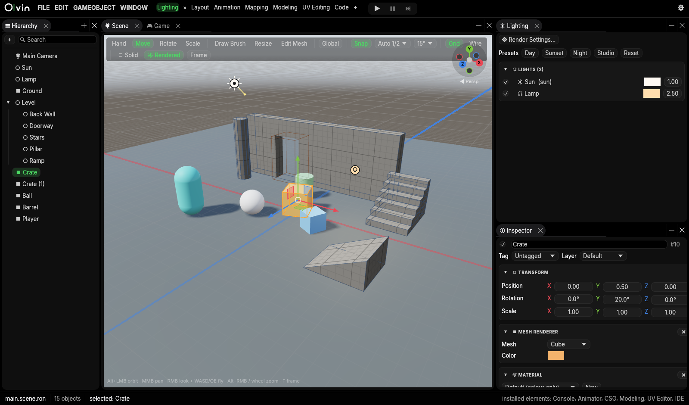
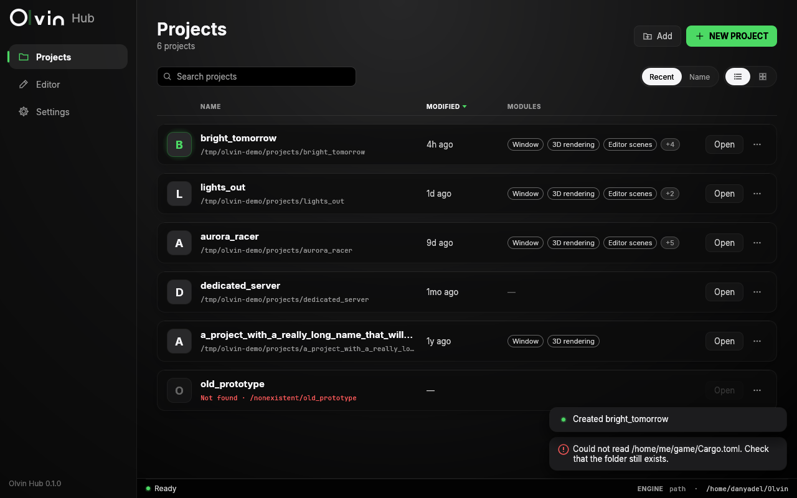
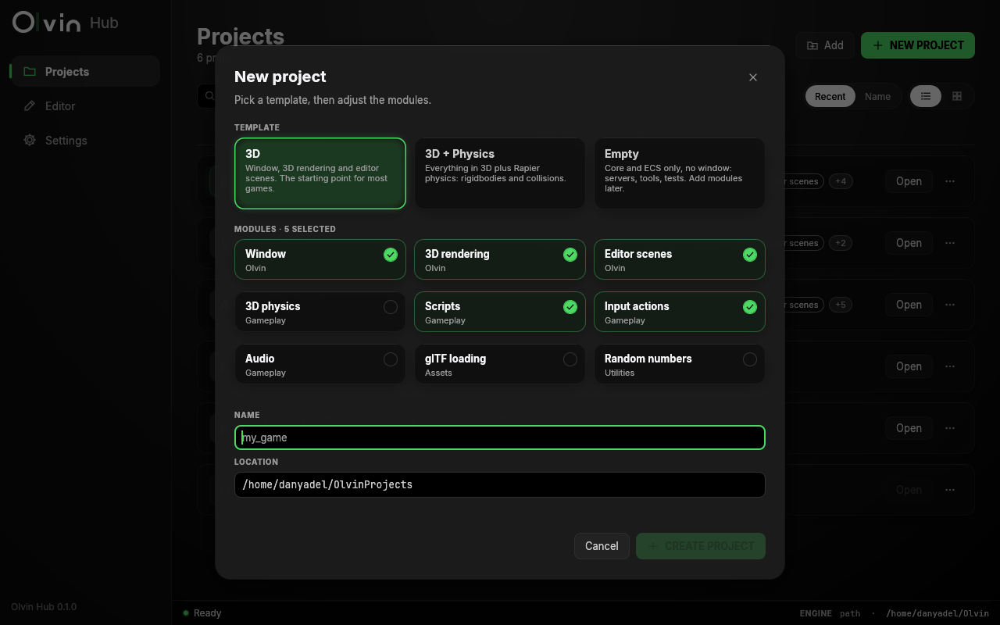
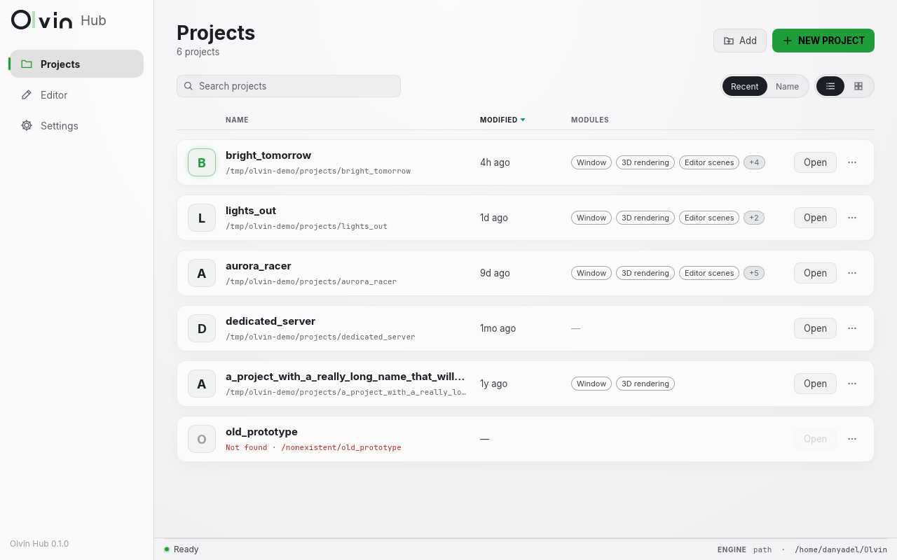
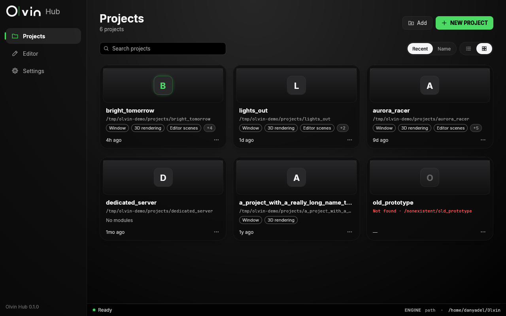
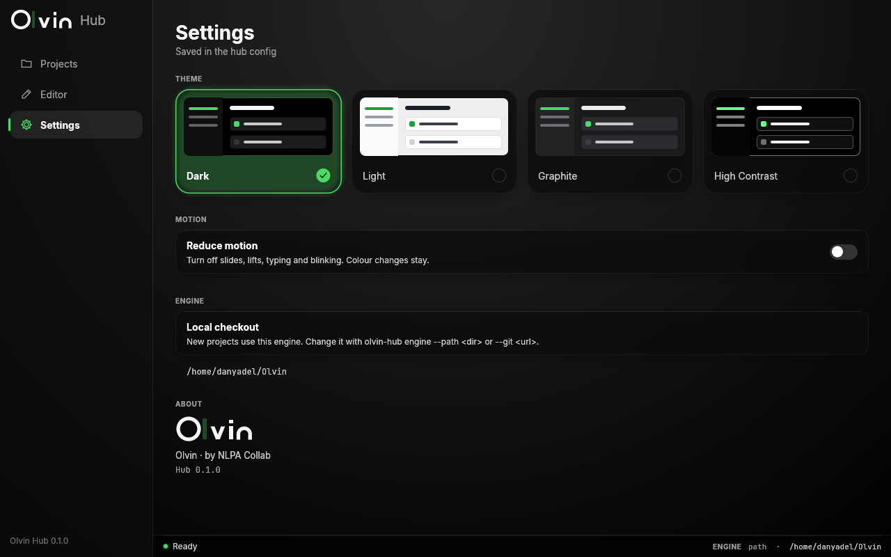
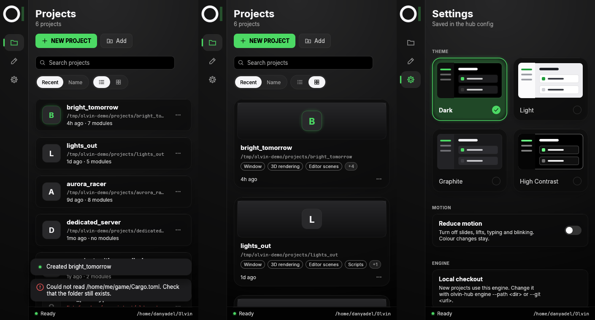
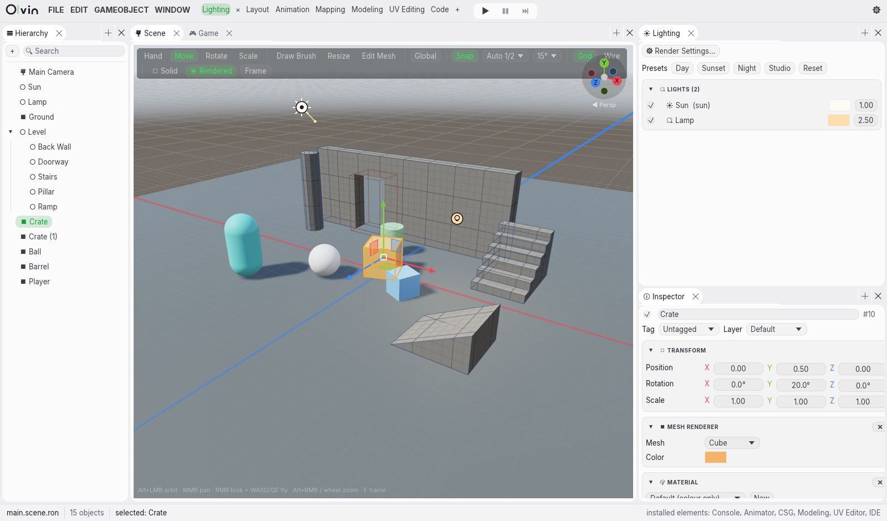

<p align="center">
  <picture>
    <source media="(prefers-color-scheme: dark)" srcset="assets/logo/variations/wordmark-flat-on-dark.svg">
    <source media="(prefers-color-scheme: light)" srcset="assets/logo/variations/wordmark-flat-on-light.svg">
    
  </picture>
</p>

<p align="center">
  Модульный игровой движок на Rust от <a href="https://nlpacollab.neocities.org/">NLPA Collab</a>.<br>
  Ядро, ECS, окно, рендер, физика и звук — отдельные крейты-плагины. Хаб для проектов и редактор сцен в комплекте.
</p>

<p align="center">
  <a href="https://github.com/DanyaDel/Olvin/actions/workflows/ci.yml"></a>
  
  
</p>

<p align="center">
  
</p>

## Что внутри

- **Модульность на уровне подсистем.** Плагин регистрирует системы, система за один вызов проходит по всем данным. Ненужное не компилируется.
- **Рендер на wgpu:** Vulkan / Metal / DX12 / GLES 3 / WebGL2 / WebGPU. Тени, PBR-материалы (`*.mat.ron`), небо и окружение, тир Compat для слабых GPU.
- **Сцены и CSG:** сцена в `assets/scenes/main.scene.ron`, игра загружает её при запуске вместе с геометрией CSG-брашей.
- **Физика** (Rapier), **звук** (kira, 3D), **ввод** с картами действий, **поведения** на Rust.
- **Хаб** создаёт проекты и ставит модули, **редактор** собирается из элементов, которые докачиваются по одному.
- **Свой стиль:** четыре темы, шрифты Inter и JetBrains Mono в комплекте, логотип рисуется геометрией. Подробно в [STYLE.md](STYLE.md).

## Быстрый старт

```sh
cargo run -p sandbox --release                 # 40k кубов, WASD + ПКМ, Shift, Esc
OLVIN_CUBES=250000 cargo run -p sandbox --release
WGPU_BACKEND=gl cargo run -p sandbox --release # слабый путь (тир Compat)
```

Нужен Rust 1.95 или новее. На Linux ещё `libudev`, `alsa-lib`, `libxkbcommon` и `wayland` (на Arch всё это уже стоит с рабочим столом).

Лог пишется в stderr и в `logs/<приложение>.log`, при панике рядом появляется отчёт `logs/crash-<время>.txt`. Уровни: `OLVIN_LOG=debug` или `OLVIN_LOG=info,olvin_render=trace`.

## Хаб

`olvin-hub` создаёт проекты игр и ставит в них модули: окно, рендер, физику, аудио и т.д. Есть консольная версия и графическая.

<p align="center">
  
</p>

<table>
  <tr>
    <td></td>
    <td></td>
  </tr>
  <tr>
    <td align="center"><sub>Новый проект: шаблон и модули</sub></td>
    <td align="center"><sub>Светлая тема</sub></td>
  </tr>
  <tr>
    <td></td>
    <td></td>
  </tr>
  <tr>
    <td align="center"><sub>Вид сеткой</sub></td>
    <td align="center"><sub>Настройки: темы и «Reduce motion»</sub></td>
  </tr>
</table>

Окно подстраивается под ширину: таблица на широком экране, карточки и узкая панель иконок на узком.

<p align="center">
  
</p>

```sh
cargo install --path hub/olvin_hub_cli   # olvin-hub
cargo install --path hub/olvin_hub_gui   # olvin-hub-gui
olvin-hub new my_game && cd my_game
olvin-hub list                 # каталог, [x] — установлено
olvin-hub add physics audio
olvin-hub run --release
```

Настройки хаба (список проектов, тема, вид) лежат в `~/.config/olvin-hub/config.toml`.

## Редактор

Редактор сцен ставится отдельно, его элементы (консоль, аниматор, моделирование, UV, IDE) докачиваются по одному:

```sh
olvin-hub editor install          # база: сцена, иерархия, инспектор, ассеты (+ консоль, CSG)
olvin-hub editor add animator     # элемент Animator и рабочая область Animation
cd my_game && olvin-hub editor open
```

<p align="center">
  
</p>

Тема и «Reduce motion» переключаются в Settings → Interface. Для разработки редактора: `cargo run -p editor_dev -- <папка проекта>` (все элементы сразу).

## Устройство

```
crates/   движок: olvin_core, olvin_ecs, olvin_window, olvin_render, olvin_scene, olvin_csg,
          olvin_mesh, olvin_assets, olvin_physics, olvin_audio, olvin_input, olvin_script,
          olvin_transform, olvin_ui (общий интерфейс хаба и редактора), olvin (фасад)
editor/   olvin_editor и его элементы: animator, console, csg, ide, modeling, uv
hub/      olvin_hub (ядро), olvin_hub_cli, olvin_hub_gui
apps/     sandbox, script_demo, editor_dev
assets/   логотип и шрифты
```

- [ARCHITECTURE.md](ARCHITECTURE.md) — что лежит в каждом крейте и как они связаны.
- [ROADMAP.md](ROADMAP.md) — план до уровня настоящего движка.
- [STYLE.md](STYLE.md) — цвета, шрифты, движение, тексты. Логотип: [assets/logo/README.md](assets/logo/README.md).

## Разработка

```sh
cargo fmt --all --check
cargo clippy --workspace --all-targets -- -D warnings
cargo test --workspace
```

Скриншоты для README рендерятся без окна, через llvmpipe:

```sh
export __EGL_VENDOR_LIBRARY_FILENAMES=/usr/share/glvnd/egl_vendor.d/50_mesa.json WGPU_BACKEND=gl
OLVIN_HUB_SHOTS=target/hub-shots OLVIN_HUB_SHOTS_ROOT=/tmp/olvin-demo \
  cargo test -p olvin_hub_gui -- --ignored screenshots
cargo test -p editor_dev --test screenshots -- --ignored   # docs/screenshots/editor-*.png
```

## Известные ограничения

- **GL на проприетарной NVIDIA под Wayland не работает.** EGL драйвера не отдаёт native-renderable конфиг, и wgpu отказывается презентовать кадр. Это ограничение wgpu, а не движка. Обход: оставить Vulkan (по умолчанию, `WGPU_BACKEND` не задавать), а для проверки GL-пути запускать на Mesa llvmpipe:

  ```sh
  __EGL_VENDOR_LIBRARY_FILENAMES=/usr/share/glvnd/egl_vendor.d/50_mesa.json WGPU_BACKEND=gl cargo run -p sandbox --release
  ```

- Хаб и редактор пока на английском, документация на русском.

## Лицензия

На выбор: [MIT](LICENSE-MIT) или [Apache-2.0](LICENSE-APACHE). Шрифты Inter и JetBrains Mono — OFL, лицензии лежат в `assets/fonts/`.

<p align="center"><sub>Olvin · by NLPA Collab</sub></p>
