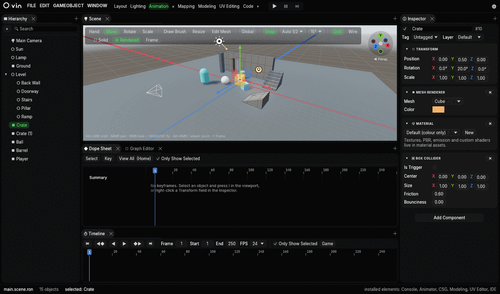

# Animation

The **Animator** element (`olvin-hub editor add animator`) provides object animation as in Blender: F-curves of transforms (Location, Rotation, Scale) with Bezier handles. The data lives in the scene (`SceneFile::animation`), so animation is saved, undone and plays in the game (`ActionPlayer`).

## Panels

| Panel | What |
|---|---|
| **Timeline** | transport, current frame, start/end, fps, key strip, scrubbing on the ruler |
| **Dope Sheet** | Summary → object → "Object Transforms" → channels, diamond keys, hold bars |
| **Graph Editor** | curves, keys and handles, visibility eyes |

The workspace template: **Animation**. 24 fps and frames 1–250 by default.

## Keys

- `I` in the viewport: keys Location, Rotation, Scale of the selection at the current frame; `Alt+I` removes keys on that frame.
- Transform fields in the inspector: yellow = a key on this frame, green = animated, orange = changed by hand. Right-click: Insert / Delete / Clear Keyframes.
- Segment interpolation (`T`): Constant, Linear, Bezier. Handle types (`V`): Free, Auto, Vector, Aligned, Auto Clamped. Handle computation, crossings and extrapolation are ported from Blender 4.x (`recalc_handles`, `eval`) and checked against a reference.
- Rotation is stored as Euler angles in degrees, interpolated per channel, no slerp.

## Playback

Space play/pause, `←`/`→` frame, `↑`/`↓` key, `Esc` stop and return to the start, `Home` show all. Keys and operations: [Hotkeys](hotkeys.md#animation). The clip in the game: `Action { autoplay, looping }`; the cycle is `frame_end - frame_start` without a hitch if the last key repeats the first.

## Models

glTF skeletal animation is set in the Model section of the inspector (a clip or an animation graph `*.animgraph.ron`). In the viewport a model stands in its default pose and is not animated.

> **Status:** there is no GPU skinning (skinning is on the CPU), see [#8](https://github.com/DanyaDel/Olvin/issues/8). Morph targets: [#10](https://github.com/DanyaDel/Olvin/issues/10). A sequencer/cutscenes is in the plan.

## See also

- [Animation (engine)](../engine/animation.md)
- [Hotkeys](hotkeys.md)
- [Scene format](../engine/scene-format.md)
- [Inspector](inspector.md)
