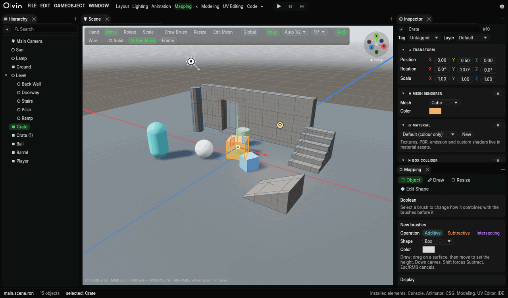

# CSG

The **CSG** element (on by default) provides level mapping in the spirit of Hammer and Realtime CSG: convex brushes (Box, Wedge, Cylinder, Pyramid, Stairs) with Add / Subtract / Intersect operations, ordered by the hierarchy. The result is built when the game loads the scene: meshes by face colour plus a "CSG Level" object with a static mesh collider.

## The Mapping window

A panel and the **Mapping** workspace. Modes: Object, Draw, Resize, Edit Shape (this is the Edit Mode of the Modeling element). Blocks: Boolean (operation, Earlier/Later, Duplicate as Carve, Hollow, Rotate 90°, Flip), New brushes, Display, Build (statistics: brushes → polygons → triangles, ms).

## Tools

| Key | Tool |
|---|---|
| `B` | **Draw Brush**: a ray picks a surface plane, a rectangle on the grid, then the height; down = subtract, `Shift` = always subtract, `Esc` / RMB cancel |
| `T` | **Resize**: 6 face handles, a face lands exactly on a grid line, the opposite stays |

**Hollow** makes a subtractive child with walls of a given thickness. Create a brush: GameObject → CSG → Box / Wedge / Cylinder / Pyramid / Stairs / Room. The CSG Brush component in the inspector: operation, shape, colour. Face material is set by the object's material.

A brush can be modeled in the common Edit Mode (`Tab`): CSG cuts by its shape (`make_editable`; Reset to Shape and Detach from CSG in the Modeling panel). A brush with a Rigidbody does not become part of the level but a separate body.

## How it is computed

`olvin_csg::build` splits faces by the planes of intersecting pieces and keeps a fragment if solidity on its two sides (±2 mm along the normal) differs. The method is robust to touching and coincident faces where BSP breaks.

## See also

- [Modeling](modeling.md)
- [Hierarchy](hierarchy.md)
- [Scene format](../engine/scene-format.md)
- [Physics](../engine/physics.md)
