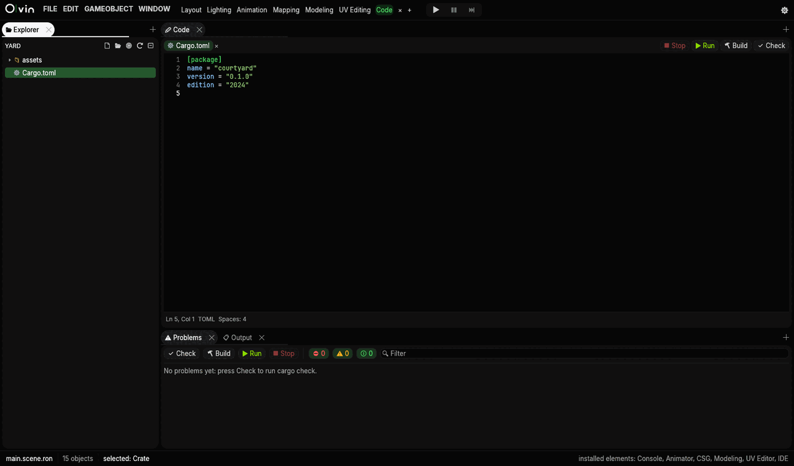

# IDE

The **IDE** element (off by default: `olvin-hub editor add ide`) provides code and shaders inside the editor: the **Code** workspace with the Explorer, Code, Problems and Output panels.

## What it does

- Highlighting for Rust, WGSL, Lua, RON, TOML, Markdown; find and replace, auto-indent, bracket pairs, `Ctrl+/`.
- Background `cargo check`, `cargo build`, `cargo run` with JSON diagnostics: Problems are clickable, output goes to Output.
- Surface shader checks through naga.
- Command palette `Ctrl+Shift+P`, go to file `Ctrl+E`, go to line `Ctrl+G`.
- While the focus is in code, `Ctrl+S` and `Ctrl+N` go to the file, not the scene.
- A file changed outside is re-read.

| Keys | Action |
|---|---|
| `Ctrl+Shift+P` | command palette |
| `Ctrl+E` | go to file |
| `Ctrl+G` | go to line |
| `Ctrl+S` | save the file |
| `Ctrl+W` | close the tab |
| `Ctrl+/` | comment |

Shaders changed in the IDE are picked up by the renderer through material hot reload (`Shaders::set`).

> **Status:** building from the IDE runs `cargo` in the project folder and does not replace `olvin-hub run`. There is no hot reload of game code: [#70](https://github.com/DanyaDel/Olvin/issues/70).

## See also

- [Materials](materials.md)
- [Console and profiler](console-profiler.md)
- [Scripting](../engine/scripting.md)
- [Hotkeys](hotkeys.md)
