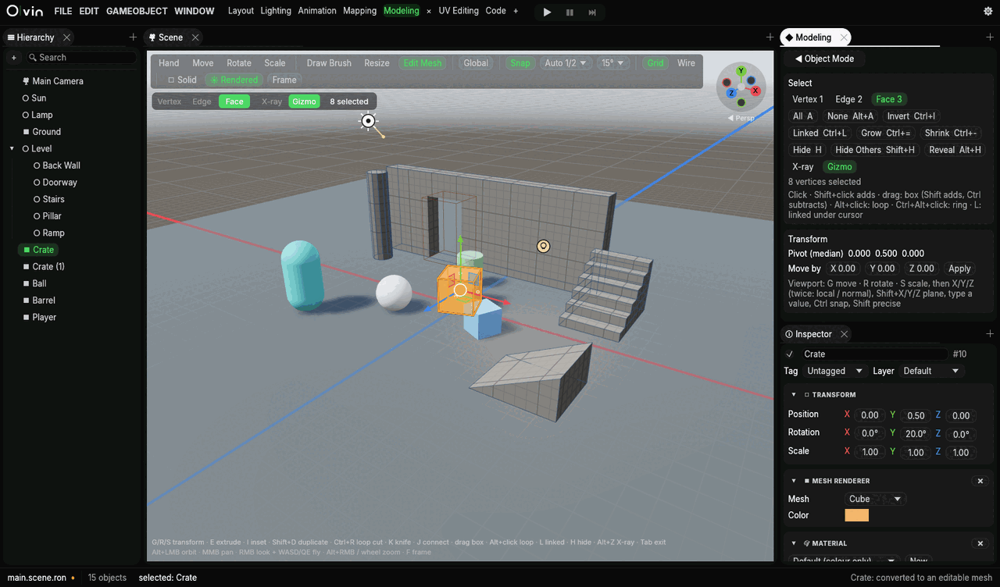

# Modeling

The **Modeling** element (on by default): Blender-style Edit Mode for objects with `poly` (`PolyMesh`) and for CSG brushes. The **Modeling** workspace; the Modeling panel duplicates the operations as buttons.

## Entering and selecting

`Tab` enters and leaves: a primitive or brush is first converted to a `PolyMesh` (`make_editable`), a brush stays a brush. Modes `1` / `2` / `3`: vertices, edges, faces. LMB drag: a box (`Shift` adds, `Ctrl` subtracts). `Alt+click`: an edge loop, `Ctrl+Alt`: a ring, in face mode a face loop. Hidden elements are dimmed, `Alt+Z` toggles X-ray. Edit Mode keys do not fire while RMB is held (WASD flight).

## Operations

Extrude (region, edges, vertices), inset, loop cut, knife, make face, fill (loop, chain, bridge), connect, dissolve, merge (to a point and by distance), flip, recalculate normals, subdivide, Catmull-Clark, triangulate. All operations keep UVs consistent.

`G` / `R` / `S` is a common modal engine: `X` `Y` `Z` axis (again: local or normal, third: reset), `Shift+axis` plane, number entry, `Ctrl` snap (grid / 5° / 0.1), `Shift` precision ×0.1, pivot at the median. A whole gesture is one undo step. The table: [Hotkeys](hotkeys.md#edit-mode-tab).

## Creating

GameObject → Mesh → Cube / Plane / Cylinder / Sphere.

## Data

`PolyMesh { positions, faces (n-gons), wire, uvs, seams }` is serialized into the scene (the object's `poly`). V is up as in Blender and is flipped when rendering.

## See also

- [UV Editor](uv.md)
- [CSG](csg.md)
- [Hotkeys](hotkeys.md)
- [Scene format](../engine/scene-format.md)
