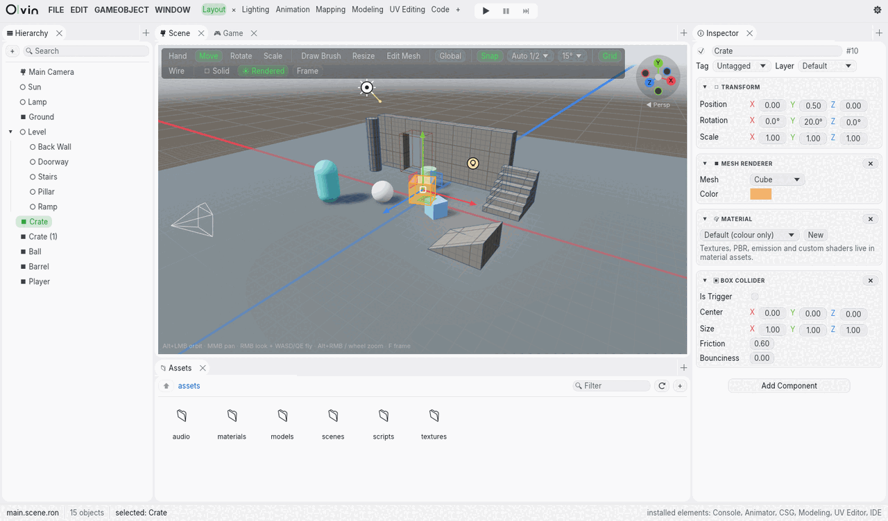

# Scene view

The Scene panel draws the scene with the same renderer as the game and the editor's geometry on top: the grid, gizmos, selection outlines, light and audio icons.

## Camera

Controls as in Unity:

| Action | Input |
|---|---|
| Pan | MMB drag or Hand (`Q`) + LMB |
| Orbit | `Alt` + LMB |
| Zoom | wheel or `Alt` + RMB |
| Fly | RMB + `W A S D` and `Q E` (down/up), `Shift` speeds up, the wheel with RMB held changes speed |
| Frame selection | `F` |
| View along an axis | click an axis of the view gizmo (±X, ±Y, ±Z) |
| Persp / Iso | click the centre of the view gizmo |

`Alt` hides the gizmo handles and disables click picking.

## Tools and gizmos

`Q` Hand, `W` Move, `E` Rotate, `R` Scale; `X` toggles Global / Local. Move: axes, planes and a free handle in the screen plane. Rotate: rings per axis and a view ring. Scale: axes and uniform scale. `Ctrl` inverts Snap: position to the grid, angle 1–90°, scale 0.1. Auto step is a power of two of the camera height and matches the grid.

Component gizmos of the selected object: colliders (green), lights (rays, sphere, cone), audio radii, Character Controller. Light and audio icons are clickable.

## Shading

`Shift+Z` or the toolbar: **Solid** (studio light from behind the camera, no scene lights, fog or tonemapping) or **Rendered** (as in the game: lights, sky, fog, shadows, materials). Post-processing (AO, LUT, FXAA) is not visible in the viewport: the editor draws into egui's own pass.

> **Status:** particles and sprites are not drawn in the viewport, animated models stand in their default pose.

## Selection

Click an object (a ray), `Ctrl+click` adds. The outline highlights the selection. In Edit Mode LMB drag is a box select, see [Modeling](modeling.md).

## Statistics

Settings → Rendering → Editor views → Viewport quality turns on a statistics overlay in the corner of the viewport (draw calls, objects, frame time); compare the Profiler panel.

## See also

- [Hotkeys](hotkeys.md)
- [Rendering](../engine/rendering.md)
- [Settings](settings.md)
- [Hierarchy](hierarchy.md)
