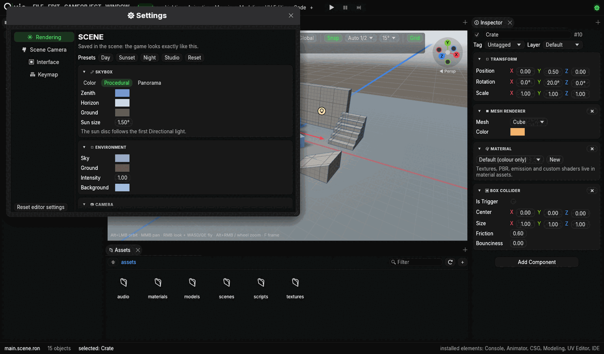

# Settings

The window **Edit → Settings…** (`Ctrl+,` or ⚙ at the top right). Values are saved on change to `<config>/olvin-editor/preferences.ron`.

| Page | What |
|---|---|
| Rendering | scene environment (saved in the scene) and the quality of editor views |
| Scene Camera | sensitivity, Invert Y, fly speed, zoom, FOV |
| Interface | theme, Reduce motion, UI scale |
| Keymap | rebind the editor and scene-view keys (see [Hotkeys](hotkeys.md)); the fixed keys table |

## Rendering

**Scene** (in the scene file, the game looks the same): ambient and sky (Color / Procedural / Texture, presets Day, Sunset, Night, Studio), exposure, ACES, fog, height fog, shadows (distance, resolution, filter Hard/PCF/Soft/PCSS, cascades, spot/point limits), post-processing (FXAA, AO, colour grading, LUT). The values: [Render settings (reference)](../reference/render-settings.md).

**Editor views** (editor views only): shadows, fog, the statistics overlay, default shading (Rendered / Solid).

## Interface

Themes: Dark, Light, Graphite, High Contrast. **Reduce motion** disables smooth transitions and the logo cursor blinking. UI scale: percent buttons.

The **Lighting** workspace (Window → New Workspace) and the Lighting window give a "Render Settings…" button, presets and a list of all lights.

> **Status:** keys are not configurable ([#45](https://github.com/DanyaDel/Olvin/issues/45)). There is no localization, the interface is English ([#38](https://github.com/DanyaDel/Olvin/issues/38) is about string tables).

## See also

- [Hotkeys](hotkeys.md)
- [Rendering](../engine/rendering.md)
- [Scene view](scene-view.md)
- [First editor run](../start/editor-first-run.md)
