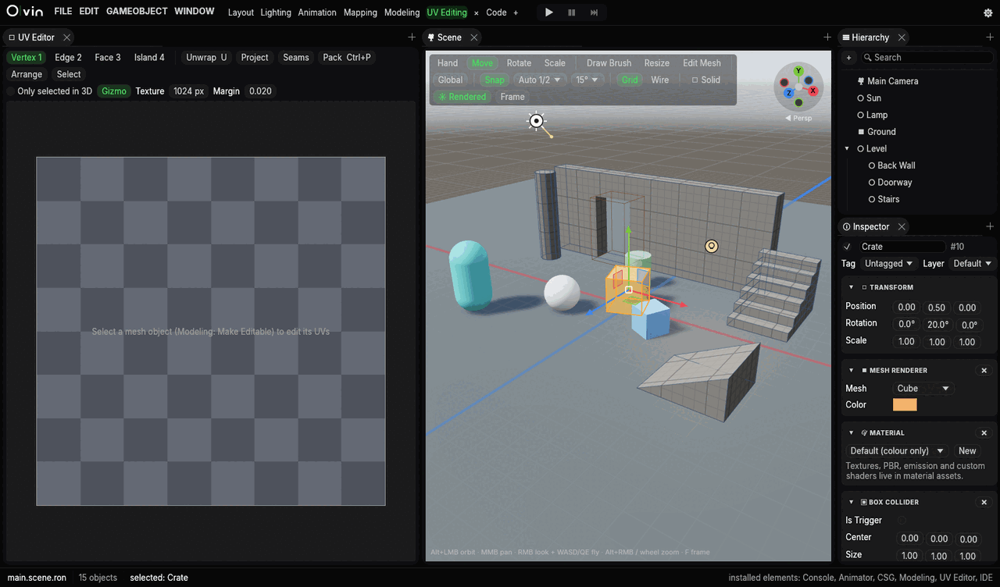

# UV Editor

The **UV Editor** element (on by default): unwrapping as in Blender, without selection sync with 3D. The "UV Editor" panel and the **UV Editing** workspace (the editor next to the scene view).

## Features

- Selecting face corners; vertex, edge, face and island modes.
- `G` / `R` / `S` with `X` / `Y` axes, number entry and `Ctrl` snap.
- Unwrap `U` (LSCM over maps cut by seams; scaled to real area, rotated to the minimal bbox), seams `Ctrl+E`, packing `Ctrl+P`.
- Projections: box, planar, cylinder, sphere, from view, follow active quads.
- flip / rotate / align, texel density.
- By default it shows only what is selected in 3D (`mesh_selection`) and the material's texture under the unwrap.

The mesh must be editable (`poly`): [Modeling](modeling.md).

## See also

- [Modeling](modeling.md)
- [Materials](materials.md)
- [Hotkeys](hotkeys.md)
- [Scene format](../engine/scene-format.md)
