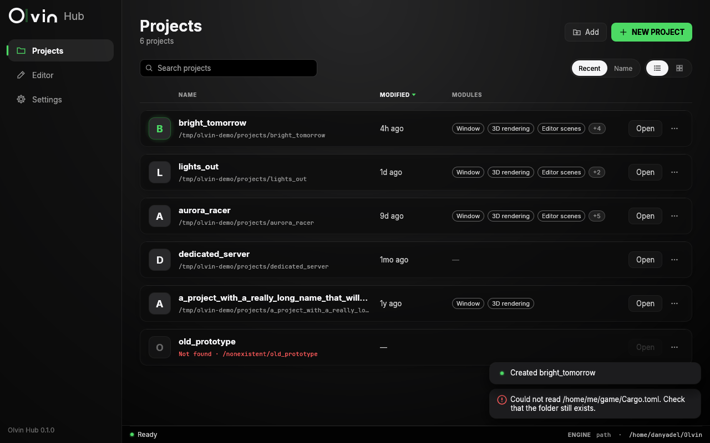
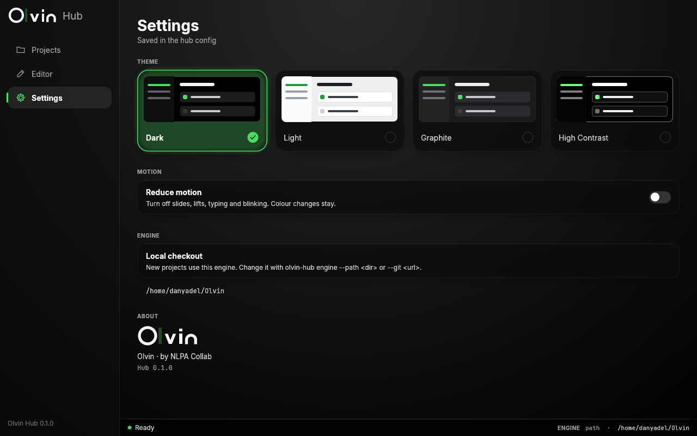

# Hub

`olvin-hub` creates game projects, installs modules into them, builds the game and installs the editor. There is a console version (`olvin-hub`) and a graphical one (`olvin-hub-gui`). The source of truth for installed modules is the project's `Cargo.toml`; the hub keeps no state of its own about it.



## Creating a project

In the GUI: `Ctrl+N` on the Projects page opens the **New project** dialog: template, name, folder, modules.

| Template | Modules |
|---|---|
| 3D | window, render, scenes, scripts, input |
| 3D + Physics | the same plus physics |
| Empty | core and ECS only, no window (servers, tools, tests) |

On the console:

```sh
olvin-hub new my_game && cd my_game
olvin-hub list                    # catalog, [x] marks installed modules
olvin-hub add physics audio lua game
olvin-hub run --release
```

The name is validated (`olvin`, `log`, `std` and keywords are reserved). The hub edits `Cargo.toml` through `toml_edit`, so comments and formatting survive; `olvin` is added with `default-features = false` and the Olvin modules become its `features`.

## Modules

The catalog is built into the hub (`hub/olvin_hub/catalog.toml`). A `kind = "olvin"` module is a feature of the [`olvin`](../reference/olvin-features.md) facade; `kind = "crate"` is a plain crates.io dependency.

| Module | What it gives | Requires |
|---|---|---|
| `window` | window, winit input | |
| `render` | wgpu: PBR, shadows, post-processing | window |
| `scenes` | loading `*.scene.ron` from the editor | render |
| `physics` | Rapier | |
| `scripts` | behaviours in Rust | |
| `lua` | behaviours in Lua 5.4 | scripts |
| `input` | action maps | window |
| `audio` | sound (kira) | |
| `game` | states, background scene loading, saves | |
| `gltf`, `rand`, `serde`, `saves` | bare crates `gltf`, `rand`, `serde`, `ron` | `saves` requires `serde` |

> **Status:** the features `gui`, `anim`, `assets`, `profile` are not in the hub catalog; add them to `Cargo.toml` by hand (as the [tutorial](../tutorial/07-ui.md) does). The `gltf` and `saves` modules install bare crates, not `olvin_assets`/`olvin_game`.

## Building the game

```sh
olvin-hub build --release                       # dist/<name>/ : exe + assets/
olvin-hub build --release --archive tar.gz      # and <name>.tar.gz (or zip)
```

More: [Hub CLI](../reference/hub-cli.md#build). The built folder runs from any working directory: the engine looks for `assets/` next to the exe, see [Project layout](../engine/project-layout.md).

## The editor

```sh
olvin-hub editor install          # build the editor (base + console, csg, modeling, uv)
olvin-hub editor list             # elements, [x] marks installed
olvin-hub editor add animator profiler ide
olvin-hub editor open             # open the project in the current folder
```

In the GUI it is the **Editor** page: element cards, changes pile up and are applied by one rebuild via the "N changes · Discard · Apply" pill, the build log is shown below. When the engine changed, a "The engine changed…" bar with a Rebuild button appears.

## Settings

The file `~/.config/olvin-hub/config.toml` (under `XDG_CONFIG_HOME` if set): project list, engine source and `[gui]` (`theme` = dark / light / graphite / high-contrast, `reduce_motion`, `view` = list / grid, `sort` = modified / name). A corrupt config is copied to `config.toml.broken` before the first write. Theme and "Reduce motion" are changed on the Settings page.



## See also

- [Installation](installation.md)
- [First editor run](editor-first-run.md)
- [olvin-hub CLI](../reference/hub-cli.md)
- [olvin features](../reference/olvin-features.md)
