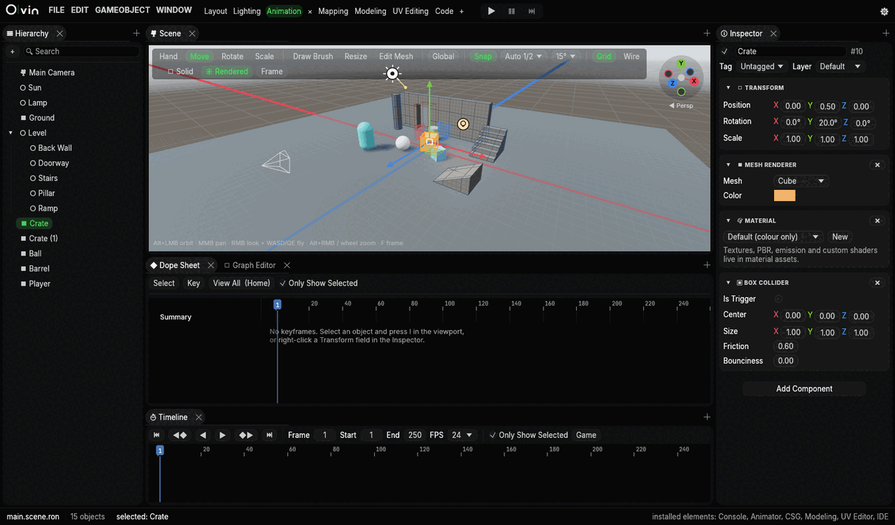

# Анимация

Элемент **Animator** (`olvin-hub editor add animator`) даёт объектную анимацию как в Blender: F-кривые трансформов (Location, Rotation, Scale) с Bezier-ручками. Данные лежат в сцене (`SceneFile::animation`), поэтому анимация сохраняется, откатывается и играет в игре (`ActionPlayer`).

## Панели

| Панель | Что |
|---|---|
| **Timeline** | транспорт, текущий кадр, старт/конец, fps, полоса ключей, скраб по линейке |
| **Dope Sheet** | Summary → объект → «Object Transforms» → каналы, ромбы-ключи, полосы удержания |
| **Graph Editor** | кривые, ключи и ручки, глазки видимости |

Шаблон рабочей области: **Animation**. По умолчанию 24 fps, кадры 1–250.

## Ключи

- `I` во вьюпорте: ключ Location, Rotation, Scale выделенного на текущем кадре; `Alt+I` удаляет ключи на кадре.
- Поля Transform в инспекторе: жёлтый = ключ на кадре, зелёный = анимировано, оранжевый = изменено вручную. ПКМ: Insert / Delete / Clear Keyframes.
- Интерполяция сегмента (`T`): Constant, Linear, Bezier. Типы ручек (`V`): Free, Auto, Vector, Aligned, Auto Clamped. Расчёт ручек, пересечений и экстраполяции перенесён из Blender 4.x (`recalc_handles`, `eval`) и сверен с референсом.
- Поворот хранится углами Эйлера в градусах, интерполяция по каналам, без slerp.

## Воспроизведение

Space play/pause, `←`/`→` кадр, `↑`/`↓` ключ, `Esc` стоп и возврат на старт, `Home` показать всё. Ключи и операции: [Горячие клавиши](hotkeys.md#анимация). Клип в игре: `Action { autoplay, looping }`; цикл `frame_end - frame_start` без заминки, если последний ключ повторяет первый.

## Модели

Скелетная анимация glTF настраивается в секции Model инспектора (клип или граф анимаций `*.animgraph.ron`). Во вьюпорте модель стоит в позе по умолчанию, не анимируется.

> **Статус:** секвенсор и катсцены в плане.

## См. также

- [Анимация (движок)](../engine/animation.md)
- [Горячие клавиши](hotkeys.md)
- [Формат сцены](../engine/scene-format.md)
- [Инспектор](inspector.md)
