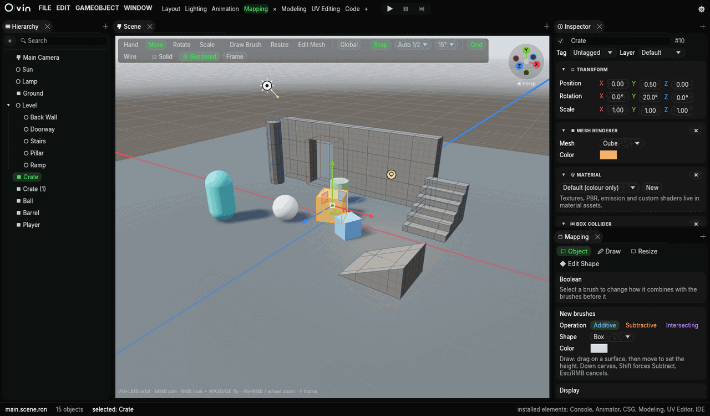

# CSG

Элемент **CSG** (по умолчанию включён) даёт маппинг уровней в духе Hammer и Realtime CSG: выпуклые браши (Box, Wedge, Cylinder, Pyramid, Stairs) с операциями Add / Subtract / Intersect, порядок задаёт иерархия. Результат собирается при загрузке сцены игрой: меши по цвету граней плюс объект «CSG Level» со статическим mesh-коллайдером.

## Окно Mapping

Панель и рабочая область **Mapping**. Режимы: Object, Draw, Resize, Edit Shape (это Edit Mode элемента Modeling). Блоки: Boolean (операция, Earlier/Later, Duplicate as Carve, Hollow, Rotate 90°, Flip), New brushes, Display, Build (статистика: браши → полигоны → треугольники, мс).

## Инструменты

| Клавиша | Инструмент |
|---|---|
| `B` | **Draw Brush**: луч выбирает плоскость поверхности, прямоугольник по сетке, затем высота; вниз = вычитание, `Shift` = вычитание всегда, `Esc` / ПКМ отменяют |
| `T` | **Resize**: 6 ручек граней, грань встаёт точно на линию сетки, противоположная остаётся |

**Hollow** делает вычитающего потомка со стенами заданной толщины. Создать браш: GameObject → CSG → Box / Wedge / Cylinder / Pyramid / Stairs / Room. Компонент CSG Brush в инспекторе: операция, форма, цвет. Материал граней задаётся материалом объекта.

Браш можно моделировать в общем Edit Mode (`Tab`): CSG режет по его форме (`make_editable`; Reset to Shape и Detach from CSG в панели Modeling). Браш с Rigidbody не входит в уровень, а становится отдельным телом.

## Как считается

`olvin_csg::build` дробит грани плоскостями пересекающихся кусков и оставляет фрагмент, если твёрдость по разные стороны (±2 мм по нормали) различается. Метод устойчив к касающимся и совпадающим граням, где BSP ломается.

## См. также

- [Моделирование](modeling.md)
- [Иерархия](hierarchy.md)
- [Формат сцены](../engine/scene-format.md)
- [Физика](../engine/physics.md)
