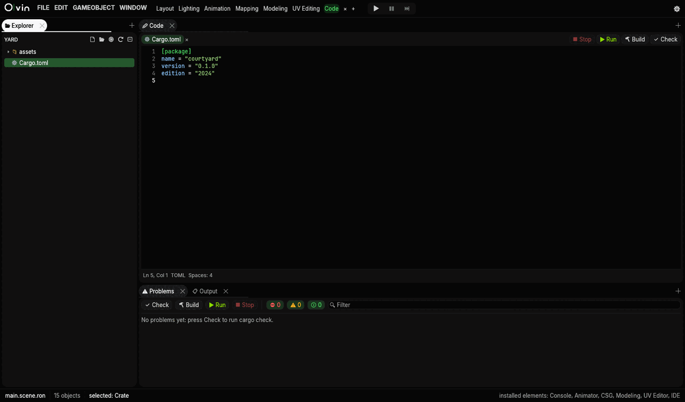

# IDE

Элемент **IDE** (по умолчанию выключен: `olvin-hub editor add ide`) даёт код и шейдеры прямо в редакторе: рабочая область **Code** с панелями Explorer, Code, Problems и Output.

## Что умеет

- Подсветка Rust, WGSL, Lua, RON, TOML, Markdown; поиск и замена, автоотступ, парные скобки, `Ctrl+/`.
- Фоновый `cargo check`, `cargo build`, `cargo run` с JSON-диагностиками: Problems кликабельны, вывод в Output.
- Проверка поверхностных шейдеров через naga.
- Палитра команд `Ctrl+Shift+P`, переход к файлу `Ctrl+E`, к строке `Ctrl+G`.
- Пока фокус в коде, `Ctrl+S` и `Ctrl+N` достаются файлу, а не сцене.
- Файл, изменённый снаружи, перечитывается.

| Клавиши | Действие |
|---|---|
| `Ctrl+Shift+P` | палитра команд |
| `Ctrl+E` | перейти к файлу |
| `Ctrl+G` | к строке |
| `Ctrl+S` | сохранить файл |
| `Ctrl+W` | закрыть вкладку |
| `Ctrl+/` | комментарий |

Шейдеры, изменённые в IDE, подхватываются рендером через горячую перезагрузку материалов (`Shaders::set`).

> **Статус:** сборка через IDE запускает `cargo` в папке проекта и не заменяет `olvin-hub run`. Горячей перезагрузки кода игры нет: [#70](https://github.com/DanyaDel/Olvin/issues/70).

## См. также

- [Материалы](materials.md)
- [Консоль и профилировщик](console-profiler.md)
- [Скрипты](../engine/scripting.md)
- [Горячие клавиши](hotkeys.md)
