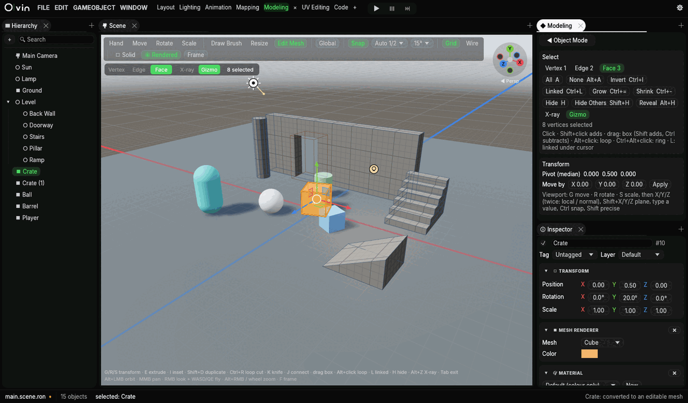

# Моделирование

Элемент **Modeling** (по умолчанию включён): Edit Mode как в Blender для объектов с `poly` (`PolyMesh`) и для CSG-брашей. Рабочая область **Modeling**, панель Modeling дублирует операции кнопками.

## Вход и выбор

`Tab` входит и выходит: примитив или браш сначала конвертируется в `PolyMesh` (`make_editable`), браш остаётся брашем. Режимы `1` / `2` / `3`: вершины, рёбра, грани. ЛКМ-перетаскивание: рамка (`Shift` добавляет, `Ctrl` вычитает). `Alt+клик`: петля рёбер, `Ctrl+Alt`: кольцо, в режиме граней: петля граней. Скрытые элементы тусклые, `Alt+Z` включает X-ray. Клавиши Edit Mode не срабатывают при зажатой ПКМ (полёт WASD).

## Операции

Экструзия (регион, рёбра, вершины), inset, loop cut, knife, make face, fill (петля, цепочка, мост), connect, dissolve, merge (в точку и по расстоянию), flip, пересчёт нормалей, subdivide, Catmull-Clark, triangulate. Все операции держат UV согласованными.

`G` / `R` / `S` это общий модальный движок: `X` `Y` `Z` ось (повтор: локальная или по нормали, третий: сброс), `Shift+ось` плоскость, ввод числа, `Ctrl` привязка (сетка / 5° / 0,1), `Shift` точность ×0,1, pivot в медиане. Жест целиком это один шаг undo. Таблица: [Горячие клавиши](hotkeys.md#edit-mode-tab).

## Создание

GameObject → Mesh → Cube / Plane / Cylinder / Sphere.

## Данные

`PolyMesh { positions, faces (n-угольники), wire, uvs, seams }` сериализуется в сцену (`poly` объекта). V вверх как в Blender, при рендере переворачивается.

## См. также

- [UV Editor](uv.md)
- [CSG](csg.md)
- [Горячие клавиши](hotkeys.md)
- [Формат сцены](../engine/scene-format.md)
