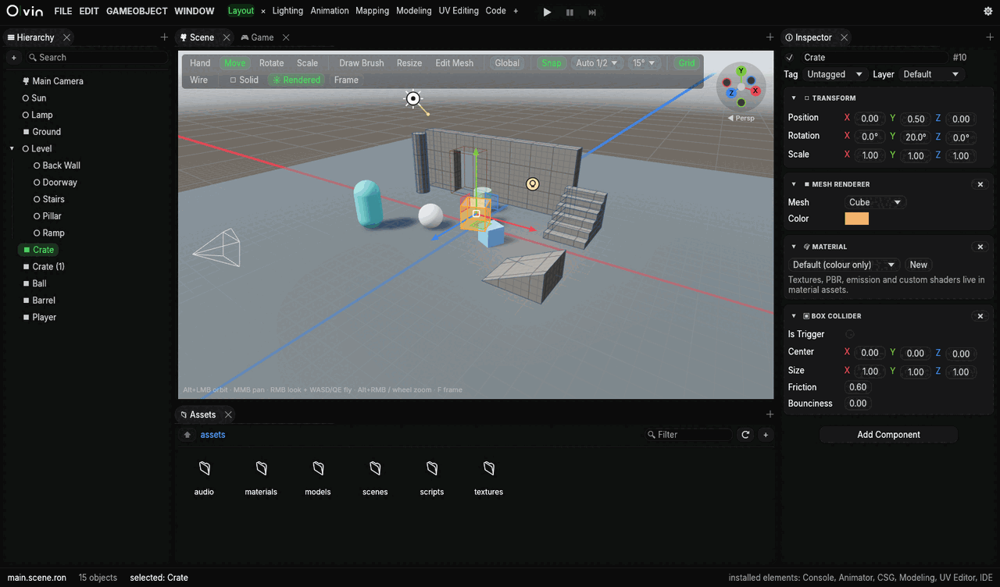

# Редактор: обзор

Редактор сцен `olvin-editor`: стиль Blender и Unity, на egui 0.36 и egui_dock, интерфейс на английском. Ставится хабом, его элементы подключаются как крейты-плагины и линкуются статически (без dylib).

## Рабочие области

Вкладки сверху работают как в браузере: клик выбирает, двойной клик переименовывает, СКМ или × закрывает, ПКМ дублирует или сдвигает, «+» создаёт новую (пустая, копия или шаблон). Внутри область это докинг: панели перетаскиваются, делятся, выносятся в окна, у каждой группы вкладок свой «+».

| Шаблон | Откуда | Что внутри |
|---|---|---|
| Layout | база | Scene, Game, Hierarchy, Inspector, Assets |
| Lighting | база | окружение, пресеты, список ламп ([Настройки](settings.md)) |
| Animation | элемент Animator | Timeline, Dope Sheet, Graph Editor ([Анимация](animation.md)) |
| Mapping | элемент CSG | уровни из брашей ([CSG](csg.md)) |
| Modeling | элемент Modeling | Edit Mode ([Моделирование](modeling.md)) |
| UV Editing | элемент UV | UV Editor рядом с видом сцены ([UV](uv.md)) |
| Code | элемент IDE | код и шейдеры ([IDE](ide.md)) |

Первый шаблон (Layout) открывается по умолчанию. Раскладка сохраняется в `<config>/olvin-editor/layout.ron` при выходе. **Window → Add Panel** добавляет любую панель, **Window → Reset Layout** сбрасывает.

## Меню и верхняя панель

- **File**: New Scene `Ctrl+N`, Save `Ctrl+S`, Save As…, Quit.
- **Edit**: Undo/Redo, Duplicate, Delete, Settings… `Ctrl+,`.
- **GameObject**: Create Empty, 3D Object, Light, Audio, Camera, Create Prefab и пункты элементов (CSG/…, Mesh/…).
- **Window**: Add Panel, New Workspace, Reset Layout.
- По центру ▶ ⏸ ⏭: Play (`Ctrl+P`), Pause, шаг кадра. Во время игры интерфейс подкрашен, в строке состояния `● PLAYING`.

## Play Mode

Play запускает настоящий `App` с физикой, вводом и скриптами Rust на копии сцены. Stop возвращает сцену и историю undo к моменту старта. Во время Play редактируется сцена «до Play», undo/redo заморожены, Save пишет её. Окно Game передаёт игре клавиатуру и мышь, пока над ним курсор.

> **Статус:** в Play не запускаются Lua-скрипты (редактор не грузит `LuaPlugin`, поэтому параметры Lua-скриптов тоже не видны в инспекторе, см. ROADMAP, пункт про Lua) и не рисуются частицы и спрайты. glTF-модели в Play стоят в позе по умолчанию.

## Undo, выделение, сохранение

- Undo/redo работает снимками: изменение фиксируется, когда отпущены мышь и клавиатура, перетаскивание это один шаг. Правки материалов и префабов тоже в истории (файлы перезаписываются при undo). Файловые операции в Assets откату не подлежат.
- Выделение: активный объект и дополнительные (`Ctrl+клик` в иерархии и вьюпорте, `Shift` в иерархии выделяет диапазон). Move, Delete и `Ctrl+D` работают со всем выделением.
- Несохранённые изменения: редактор спросит перед закрытием и перед заменой сцены.

## См. также

- [Иерархия](hierarchy.md)
- [Инспектор](inspector.md)
- [Сцена и вьюпорт](scene-view.md)
- [Горячие клавиши](hotkeys.md)
- [Первый запуск редактора](../start/editor-first-run.md)
