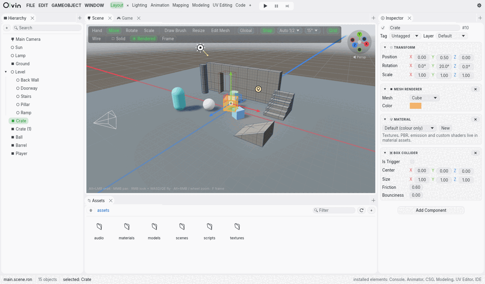

# Сцена и вьюпорт

Панель Scene рисует сцену тем же рендерером, что и игра, и поверх него геометрию редактора: сетку, гизмо, контуры выделения, иконки света и звука.

## Камера

Управление как в Unity:

| Действие | Ввод |
|---|---|
| Сдвиг | СКМ-перетаскивание или Hand (`Q`) + ЛКМ |
| Орбита | `Alt` + ЛКМ |
| Масштаб | колесо или `Alt` + ПКМ |
| Полёт | ПКМ + `W A S D` и `Q E` (вниз/вверх), `Shift` ускоряет, колесо при зажатой ПКМ меняет скорость |
| Кадрировать выделение | `F` |
| Вид по оси | клик по оси гизмо вида (±X, ±Y, ±Z) |
| Persp / Iso | клик по центру гизмо вида |

`Alt` прячет ручки гизмо и отключает выбор кликом.

## Инструменты и гизмо

`Q` Hand, `W` Move, `E` Rotate, `R` Scale; `X` переключает Global / Local. Move: оси, плоскости и свободная ручка в плоскости экрана. Rotate: кольца по осям, кольцо вида. Scale: оси и равномерный масштаб. `Ctrl` инвертирует привязку (Snap): позиция по сетке, угол 1–90°, масштаб 0.1. Шаг Auto это степень двойки от высоты камеры, он совпадает с сеткой.

Гизмо компонентов выделенного: коллайдеры (зелёные), свет (лучи, сфера, конус), радиусы звука, Character Controller. Иконки света и звука кликабельны.

## Shading

`Shift+Z` или тулбар: **Solid** (студийный свет из-за камеры, без сцены-света, тумана и тонмаппинга) или **Rendered** (как в игре: свет, небо, туман, тени, материалы). На Vulkan, Metal и DX12 (тир Full) вьюпорт и окно Game проходят через ту же пост-цепочку, что и игра: блум, AO, FXAA, цветокоррекция и LUT, тонмаппинг, ретро-разрешение. Сцена рисуется в HDR-текстуру, а готовая картинка вклеивается в окно вместе с глубиной, поэтому сетка и гизмо по-прежнему прячутся за объектами. Settings → Viewport quality → Post-processing выключает блум, AO и цветокоррекцию (экспозиция и тонмаппинг остаются). На GL (тир Compat) пост-цепочки нет, как и в игре.

> **Статус:** частицы и спрайты во вьюпорте не рисуются, анимированные модели стоят в позе по умолчанию.

## Выделение

Клик по объекту (луч), `Ctrl+клик` добавляет. Контур подсвечивает выделенное. В Edit Mode ЛКМ-перетаскивание это рамка, см. [Моделирование](modeling.md).

## Статистика

Settings → Rendering → Editor views → Viewport quality включает оверлей статистики в углу вьюпорта (draw calls, объекты, время кадра), ср. панель Profiler ([Профилировщик](console-profiler.md)).

## См. также

- [Горячие клавиши](hotkeys.md)
- [Рендер](../engine/rendering.md)
- [Настройки](settings.md)
- [Иерархия](hierarchy.md)
