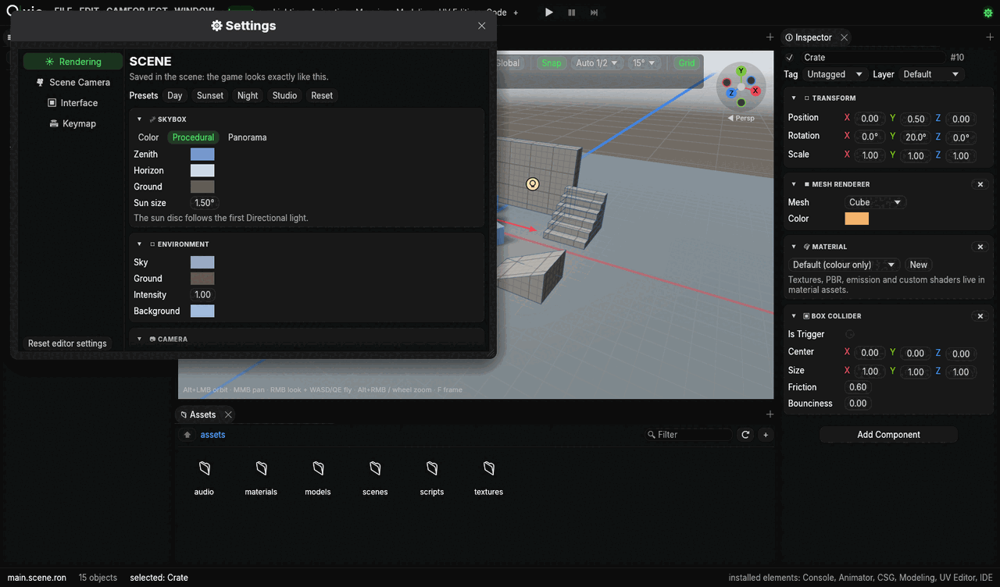

# Настройки

Окно **Edit → Settings…** (`Ctrl+,` или ⚙ справа сверху). Значения сохраняются при изменении в `<config>/olvin-editor/preferences.ron`.

| Страница | Что |
|---|---|
| Rendering | окружение сцены (сохраняется в сцене) и качество видов редактора |
| Scene Camera | чувствительность, инверсия Y, скорость полёта, зум, FOV |
| Interface | тема, Reduce motion, масштаб UI |
| Keymap | переназначение клавиш редактора и вида сцены (см. [Горячие клавиши](hotkeys.md)); таблица фиксированных клавиш |

## Rendering

**Scene** (в файле сцены, игра выглядит так же): ambient и небо (Color / Procedural / Texture, пресеты Day, Sunset, Night, Studio), экспозиция, ACES, туман, height fog, тени (дистанция, разрешение, фильтр Hard/PCF/Soft/PCSS, каскады, лимиты spot/point), post-processing (FXAA, AO, цветокоррекция, LUT). Значения: [Настройки рендера (справочник)](../reference/render-settings.md).

**Editor views** (только виды редактора): тени, туман, оверлей статистики, вид по умолчанию (Rendered / Solid).

## Interface

Темы: Dark, Light, Graphite, High Contrast. **Reduce motion** отключает плавные переходы и мигание курсора логотипа. Масштаб UI: кнопки процентов.

Рабочая область **Lighting** (Window → New Workspace) и окно Lighting дают кнопку «Render Settings…», пресеты и список всех ламп.

> **Статус:** клавиши не настраиваются ([#45](https://github.com/DanyaDel/Olvin/issues/45)). Локализации нет, интерфейс английский ([#38](https://github.com/DanyaDel/Olvin/issues/38) про таблицы строк).

## См. также

- [Горячие клавиши](hotkeys.md)
- [Рендер](../engine/rendering.md)
- [Сцена и вьюпорт](scene-view.md)
- [Первый запуск редактора](../start/editor-first-run.md)
