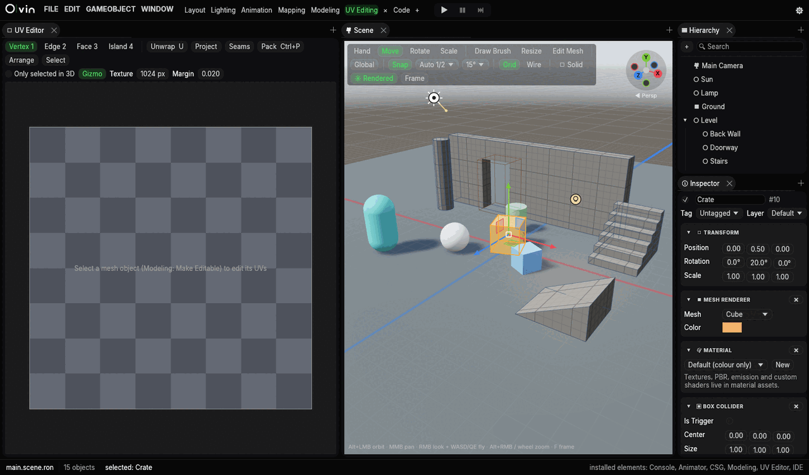

# UV Editor

Элемент **UV Editor** (по умолчанию включён): развёртка как в Blender, без синхронизации выделения с 3D. Панель «UV Editor» и рабочая область **UV Editing** (редактор рядом с видом сцены).

## Возможности

- Выделение углов граней; режимы вершина, ребро, грань, остров.
- `G` / `R` / `S` с осями `X` / `Y`, вводом чисел и привязкой `Ctrl`.
- Unwrap `U` (LSCM по картам, разрезанным швами; масштаб к реальной площади, поворот к минимальному bbox), швы `Ctrl+E`, упаковка `Ctrl+P`.
- Проекции: box, planar, cylinder, sphere, from view, follow active quads.
- flip / rotate / align, texel density.
- По умолчанию показывает только выделенное в 3D (`mesh_selection`) и текстуру материала под развёрткой.

Меш должен быть редактируемым (`poly`): [Моделирование](modeling.md).

## См. также

- [Моделирование](modeling.md)
- [Материалы](materials.md)
- [Горячие клавиши](hotkeys.md)
- [Формат сцены](../engine/scene-format.md)
