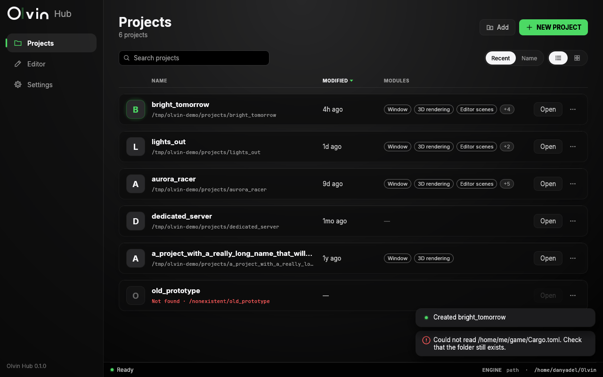
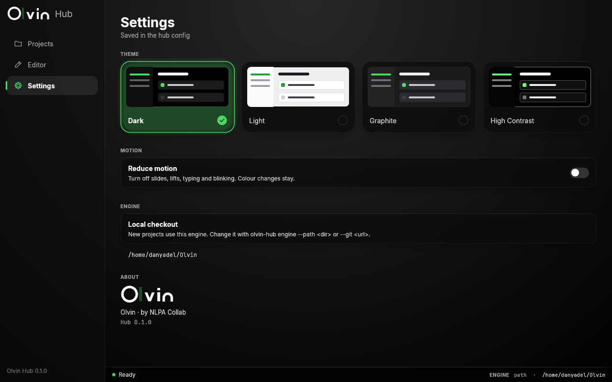

# Хаб

`olvin-hub` создаёт проекты игр, ставит в них модули, собирает игру и устанавливает редактор. Есть консольная версия (`olvin-hub`) и графическая (`olvin-hub-gui`). Источник правды об установленных модулях: `Cargo.toml` проекта, своего состояния у хаба нет.



## Создание проекта

Графически: `Ctrl+N` на странице Projects открывает диалог **New project**: шаблон, имя, папка, модули.

| Шаблон | Модули |
|---|---|
| 3D | window, render, scenes, scripts, input |
| 3D + Physics | то же и physics |
| Empty | только ядро и ECS, без окна (серверы, инструменты, тесты) |

В консоли:

```sh
olvin-hub new my_game && cd my_game
olvin-hub list                    # каталог, [x] отмечает установленное
olvin-hub add physics audio lua game
olvin-hub run --release
```

Имя проверяется (`olvin`, `log`, `std` и ключевые слова зарезервированы). Хаб правит `Cargo.toml` через `toml_edit`, комментарии и форматирование сохраняются; `olvin` подключается с `default-features = false`, модули Olvin становятся его `features`.

## Модули

Каталог встроен в хаб (`hub/olvin_hub/catalog.toml`). Модуль `kind = "olvin"` это фича фасада [`olvin`](../reference/olvin-features.md); `kind = "crate"` обычная зависимость с crates.io.

| Модуль | Что даёт | Требует |
|---|---|---|
| `window` | окно, ввод winit | |
| `render` | wgpu: PBR, тени, постобработка | window |
| `scenes` | загрузка `*.scene.ron` из редактора | render |
| `physics` | Rapier | |
| `scripts` | поведения на Rust | |
| `lua` | поведения на Lua 5.4 | scripts |
| `input` | карты действий | window |
| `audio` | звук (kira) | |
| `game` | состояния, фоновая загрузка сцен, сохранения | |
| `gltf`, `rand`, `serde`, `saves` | голые крейты `gltf`, `rand`, `serde`, `ron` | `saves` требует `serde` |

> **Статус:** фичи `gui`, `anim`, `assets`, `profile` в каталоге хаба нет, их добавляют в `Cargo.toml` вручную (так делает [туториал](../tutorial/07-ui.md)). Модули `gltf` и `saves` ставят голые крейты, а не `olvin_assets`/`olvin_game`.

## Сборка игры

```sh
olvin-hub build --release                       # dist/<имя>/ : exe + assets/
olvin-hub build --release --archive tar.gz      # и <имя>.tar.gz (или zip)
```

Подробнее: [CLI хаба](../reference/hub-cli.md#build). Собранная папка запускается из любой рабочей папки: движок ищет `assets/` рядом с exe, см. [Раскладка проекта](../engine/project-layout.md).

## Редактор

```sh
olvin-hub editor install          # собрать редактор (база + console, csg, modeling, uv)
olvin-hub editor list             # элементы, [x] установленные
olvin-hub editor add animator profiler ide
olvin-hub editor open             # открыть проект из текущей папки
```

В графическом хабе то же на странице **Editor**: карточки элементов, изменения копятся и применяются одной пересборкой плашкой «N changes · Discard · Apply», журнал сборки показывается внизу. Если движок изменился, появляется плашка «The engine changed…» с кнопкой Rebuild.

## Настройки

Файл `~/.config/olvin-hub/config.toml` (с `XDG_CONFIG_HOME`: оттуда): список проектов, источник движка и `[gui]` (`theme` = dark / light / graphite / high-contrast, `reduce_motion`, `view` = list / grid, `sort` = modified / name). Повреждённый конфиг копируется в `config.toml.broken` до первой записи. Тема и «Reduce motion» меняются на странице Settings.



## См. также

- [Установка](installation.md)
- [Первый запуск редактора](editor-first-run.md)
- [CLI olvin-hub](../reference/hub-cli.md)
- [Фичи olvin](../reference/olvin-features.md)
